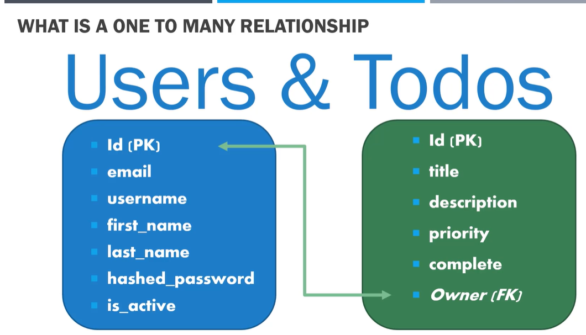
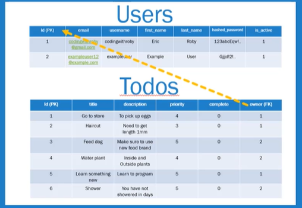

## One to many relationship

* So what does one to many relations mean when talking about SQL tables? Well, when it comes to our application, this means a single user can have multiple todos (records). However, A todo cannot have multiple users.

* Now in our application, we can have multiple users, each with a bunch of todos for themselves.

* We have 2 tables in database 

    - `users` &rarr; having ID as a primary key, email, username, first name, last name, hashed password and is active.

    - `todos` &rarr; having ID primary key, todo, description, priority and complete.

    - In this setup, to connect a single user to many different todo records, we need to add some `additional` field to the `column` of our `Todos` table. This new field will be called `owner (FK)` `FK` which means a `Foreign key`. It holds the `primary key of the user record` so we can locate that `specific todo by the user ID` field.

    

    **What is a Foreign Key?**
    - A column within a relational database table that provides a link between two separate tables.
    - A foreign key references primary key of another table, and most relational databases need foreign keys to be able to link tables together to present a sequence of data.

    

    - The foreign key column is only in todos table but not in users table because we're only refrencing the todos to user due to one to many relationship and not the other way.

    ```
    SELECT * FROM todos;
    ```
    > Get all rows and columns from todos table

    ```
    SELECT * FROM users;
    ```
    > Get all rows and columns from users table

    - how would you reference the users from the todo?

        - each API will have a user ID attached when we're requesting todos. If we have the ID attached to each request, we can use the ID to find their todos.

        - We can find the user ID from the JWT, which is a JSON web token that will be extracting.
    
    ```
    SELECT * FROM todos WHERE owner=1;
    ```
    > Get all rows and columns from todos table with user ID = 1 in users table

* For this, we'll be using `todosapp.db` as our db file instead of `todo.db` used earlier in the `database.py` file. Also, update teh `models.py` file to have the `new column in todos table` and also to create `users` table