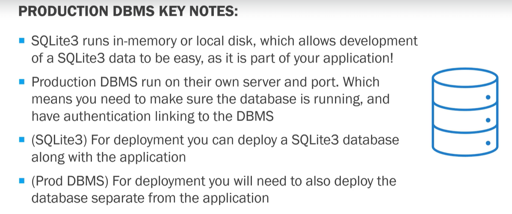
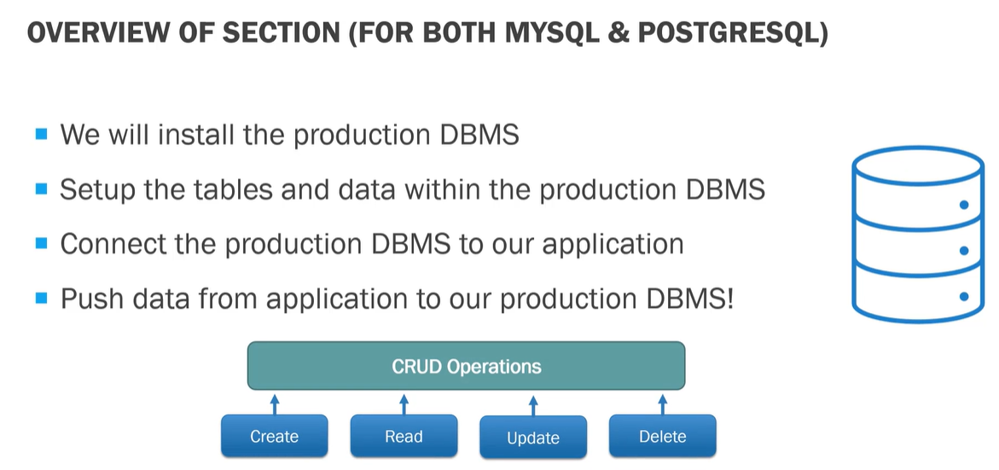

## Production Database (DBMS)

* This covers the installation/setup of production relational database for the application.
* The two DBMS, also known as database management systems, covered in this include [_MySQL_](production-MySQL.md) in [_PostgreSQL_](production-database.md).

**Production DBMS v/s SQLite database**

* `**SQLite DB**`

    - strives to provide local data storage for individual applications and devices.
    - emphasizes economy, efficiency and simplicity.
    - easy to use and easy to set up. It is literally on the same server of your application, which makes it very efficient for applications.
    - for most small and medium sized applications it works really well. Once an application starts with a SQLite, we can always expand it to use a production database.
    - focuses on different concepts than a production database management system, which again includes the efficiency and simplicity of use.

* `**Production DB**`
    - focuses on big differences compared to SQLite.
    - focus on scalability, concurrency and control, these production databases can grow more efficiently and typically offer better capability than SQLite.
    - If your application is going to have tens of thousands of users, it may be wise to switch to a production database management system. If your application is starting off with a small amount of users, you can definitely use SQLite.

**Production IBM's keynotes?**

**Overview of this section**

