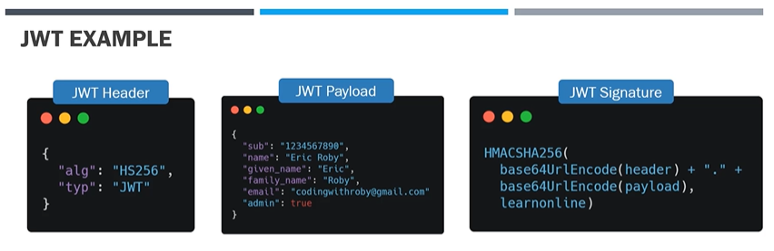
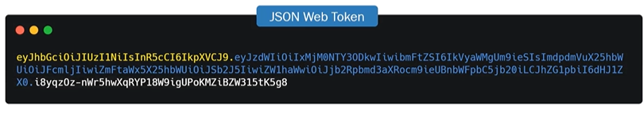

## Project three

* we will be switching our focus to doing `TODOS` instead of using `BOOKS` as our primary object.
* To create this project, in the `PyCharm` &rarr; `right click` on the parent folder where we have the virtual environment &rarr; New &rarr; `Python Package` &rarr; Name the project (eg: project-3-Todos)

* New information will include:
    - `Database`
        - Full `SQL database`. This database is going to have all of the records and tables that we need for a full fledged database.
        - We'll start this project with using `SQLite`, which is an easy embedded database and our application.
        - We then see step by step on how to use two extremely popular and production databases, `PostgreSQL` and `MySQL`.
    - `Authentication`
        - how we can get authentication with JWT and our application.
        - And that ultimately means being able to create users that have a username and password.
    - `Authorization`
        - roles and responsibilities where a user can be an admin and they get certain API endpoints available that other users do not get.

        > [_How Authentication and Authorization work in FastAPI_](#authentication-and-authorization-in-fastapi)
    - `Hashing Passwords`
        - As we deal with user authentication and authorization, we need to hash the password before we save them into the database.
        - step by step on how to create a hashing algorithm for our application to be able to hash all of the passwords that we save as records.
        - we need to install the below dependencies &rarr; `passlib` and `bcrpyt==4.0.1 (specific version)`

        ```
        pip install passlib bcrypt==4.0.1
        ```

        > We need to use this specific version of bcrypt becuase the passwords hashed by one version


**Creating a Todo Table**
- we will create a new `Todo` table model for our application.
- We will be using these Todos to save records throughout this project.
- Once we have the required `database.py` and `models.py` files created in database folder, create a `main.py` in project folder and run the below commands.

```
cd <project folder>
```
eg:
> cd ./project-3-Todos

```
uvicorn main:app --reload
```
> This will create a .db file in the location (SQLALCHEMY_DATABASE_URL) specified in database.py file

- Once the db file is created, install `SQLite` to connect and manage the data.

**General Info**

`Pydantic v1` vs `Pydantic v2`

* FastAPI is now compatible with both Pydantic v1 and Pydantic v2.

* Based on how new the version of FastAPI you are using, there could be small method name changes.

* The three biggest are:

    - `.dict()` function is now renamed to `.model_dump()`
    - `schema_extra` function within a Config class is now renamed to `json_schema_extra`
    - Optional variables need a `=None` example: `id: Optional[int] = None`

### Authentication and Authorization in FastAPI

* Allow a user to be able to authenticate themselves so they can sign in as this user uing the details saved in the database.

* Create an API endpoint, in `auth.py` file, as a `POST` request method with a path of `/token`. A token is what we're going to return back to the user which will have all of the information about the user inside. And this token is going to be a `JWT`, which is a JSON web token. This require to install a dependency `python-multipart`

```
pip install python-multipart
```
> we can now submit forms to our application. But we're not going to be using a normal fast API form. We're going to be using something called OAuth to password request form. It's a special kind of form that will be slightly more secure and will have its own portal on Swagger. Where we will be able to get the username and password for the request.

* After installing, import this functionality in `auth.py`
```
from fastapi.security import OAuth2PasswordRequestForm
```

* once we import this request form, we now need to use it as a dependency injection for our API endpoint. Also, add the database as another dependency (same as for create user endpoint). 

* **What is a Json web token (JWT)?**
    - `JWT` is one of the most popular bearer tokens and authorization protocols within APIs.

    - It is a self-contained way to se`curely transmit data and information` between two or more parties using a JSON object.

    - A Json web token can be trusted because each JWT can be `digitally signed`, which in turn allows a server to know if the Json object has been changed at all from the client.

    - JWT is `not an authentication method` like basic and digest, `but an authorization method` which allows the client and server to maintain a relationship without having to log in each request.

    - JWT is a great way for information to be exchanged between the server and client.
        - Once a user logs in, the server will return a Json web token, which is a string of characters that, when decoded, shows information about the client and user.

        - Each time a request comes from the same client. After a successful authentication, the client will send the Json web token and the server will validate the token each request.

    - All Json web tokens have similar structures.
        - A Json web token is created by three separate parts separated by dots(.) which include &rarr; a `header`, `payload` and `signature`, Therefore, a Json web token being sent between the client and the server willhave unique characters for that specific client
        ```
        <header>.<payload>.<signature> 
        ```

        - `JWT Header`
            - consist of 2 parts &rarr; `algorithm` for signing and the `type` of token.
            - The JWT header is then encoded using Base64 to create the first part of the Json web token.
        - `JWT Payload`
            - consists of the `actual data` of the user and or additional information. The payloads data contains `claims`, and there are `three` types of claims.
                - `register` &rarr; predefined, recommended but not mandatory &rarr; top 3 include:
                    - `iss` &rarr; stands for issuer. This claim identifies the principal that issued the JWT.
                    - `sub` &rarr; stands for subject and holds statements about the subject. The subject value must be scoped either locally or globally unique. Think of a subject as an ID for the Json web token.
                    - `exp` &rarr; stands for expiration time, which is when the JWT expires. This claim makes sure that the current date and time is before the expiration date and time of the token. Expiration is not mandatory, but extremely useful.
                        - Always enure there is some type of default expiration date attached to the JWT. Because if the token never expires, then anyone who has a JWT will be authorized by the server.
                
                - `public`
                - `private`.

            - The JWT payload is then encoded using Base64 to create the second part of the JWT.

        - `JWT Signature`
            - third and final part of a Json web token.
            - The JWT signature is created by using the algorithm in the header to hash out the encoded header, encoded payload with secret.
            - The secret can be anything but is saved somewhere on the server that the client does not have access to.
        
    
            
    - With all of this combined, we get the Json web token string which is unique to the client based on the authentication of the user that has logged in.

    

    - However, the JWT is safe as long as the client does not find out the secret key, which in this example is learn online. If the client was able to discover the secret key, they would have so much more control over the data. If you visit https://jwt.io, you can encode and decode your very own Json web tokens.

    - If any of the information on the JWT has changed, the server will be able to identify that something was altered. we can see an invalid signature.

* **So what are some practical use cases?**

    - A single company or enterprise has multiple different applications that many different users work with and do not want your user to have to sign into each application. This is possible if all apps share the same secret. This means servers of all apps would be able to handle decoding the Json web token and know exactly who the user is that is trying to perform the action.

    - Using JWT is extremely popular in modern architectures like microservices, where each API may be loosely coupled and in some cases completely stateless but require user information. These micro services or micro APIs can find the user by decoding tokens and never having to implement authentication or authorization within the specific API.