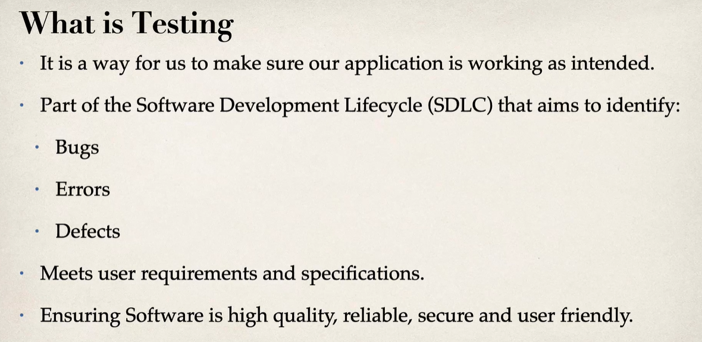
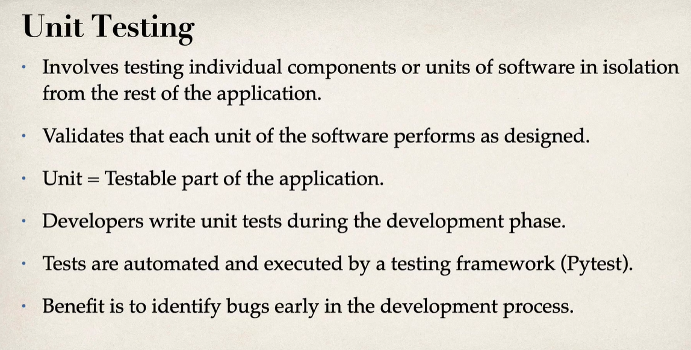
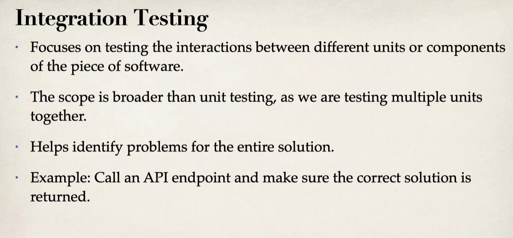
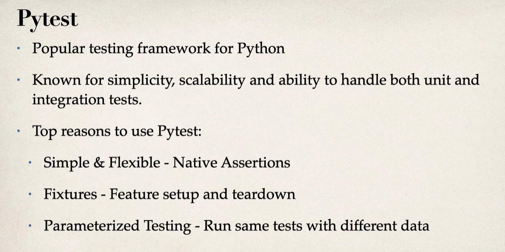
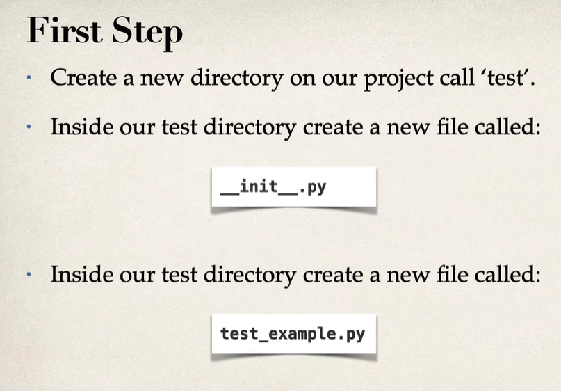
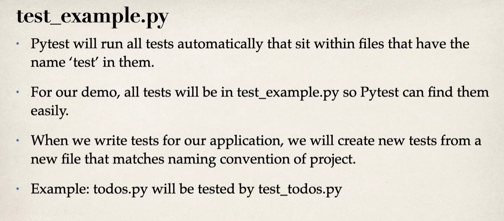
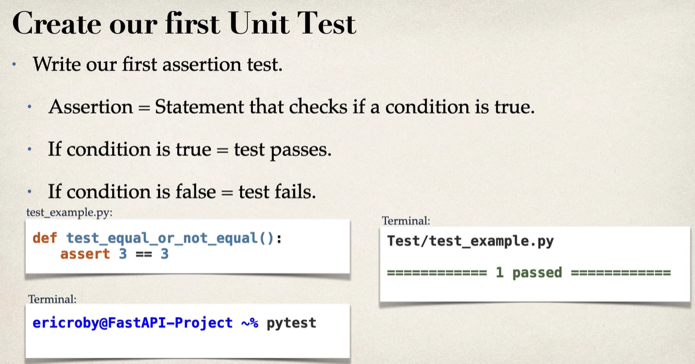
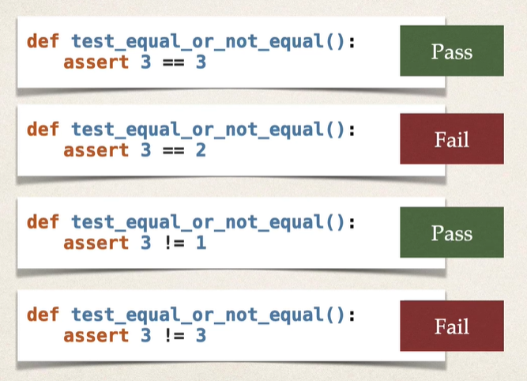

## FastAPI Testing

1. [_What is testing_](#what-is-testing)
2. [_Types of testing_](#types-of-testing)
3. [_How to test_](#how-to-test)

#### What is testing

#### Types of testing

* **_`Manual Testing`_**
    - what we have done in previous sections by running the application and test it with different pattern of inputs to ensure all the functionalities are working as expected.

* **_`Unit Testing`_**

* **_`Integration Testing`_**

#### How to test

* We will be using `Pytest`

> To ensure `PyTest`, which is going to be the framework that we use for unit testing, is able to know that this is a test file, the easiest way to do that is just start the file with `test_<xxxx>` and the functions also start with `test`

