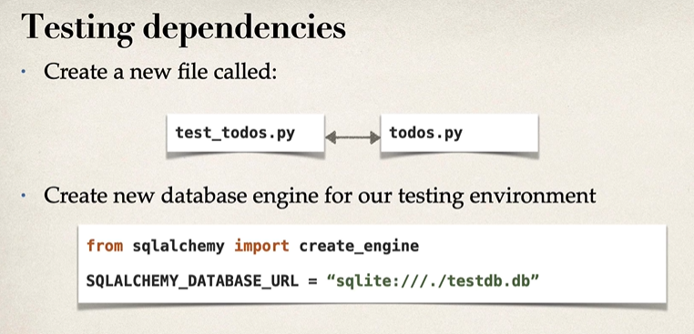
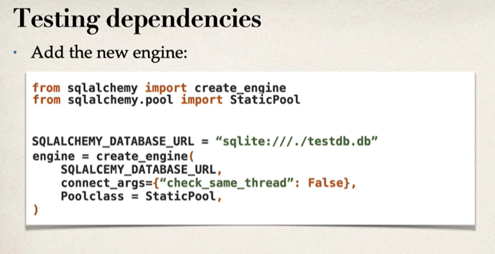
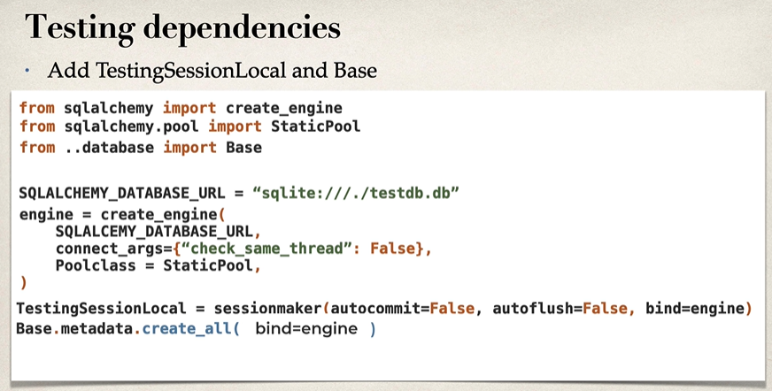
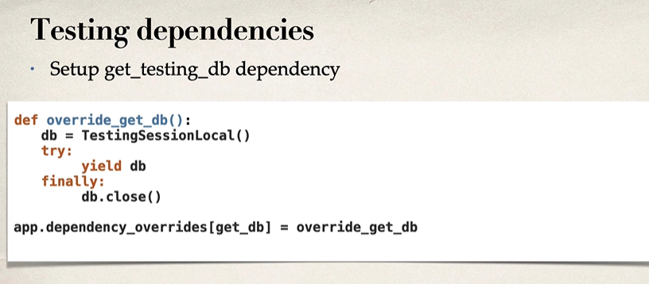
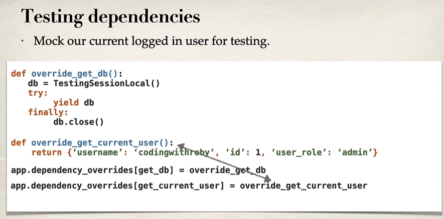
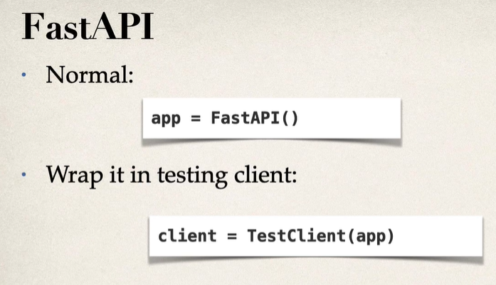

## Setting up the test dependencies and a test DB

* A fake DB that can store date and will be used only for tests, separate from prod DB.

* create testing dependencies that are separate from our production dependencies. This way we can do integration testing to make sure our entire project is working correctly when we run our tests.

* So when our app is live, we're going to be using our production dependencies and our production database. But when we run our tests, we're going to be using our testing dependencies and our testing database.

> we'll have all of this in a separate shared dependencies in a different file later on. So we're going to have our shared dependencies separated within our application.

#### Creating testing dependencies

* Create a new file and a database engine.

* Add the engine

* Add TestingSessionLocal and Base

* Setup get_testing_db_dependency

* Mock the current logged in user for testing

* Normal setup, we have the `app = FastAPI()`. However, to make sure fast API knows this is a testing environment, we need to wrap it in a testing client.

